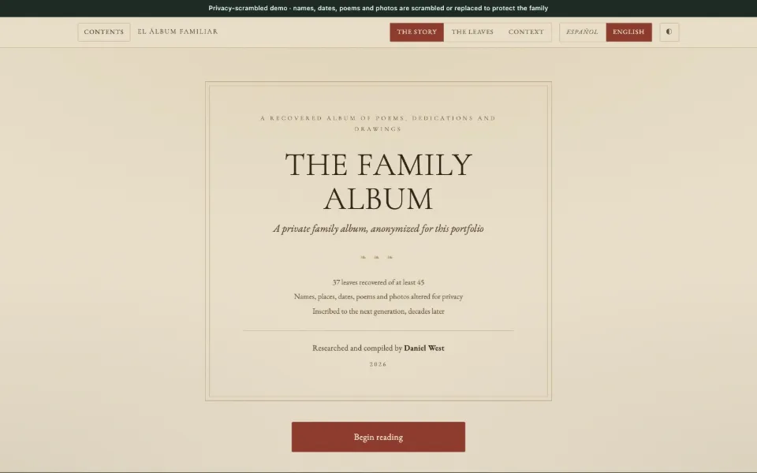
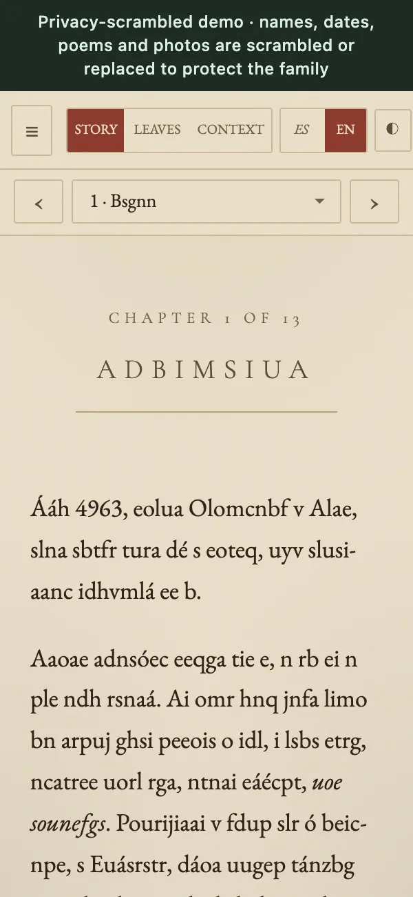

<picture>
  <source media="(prefers-color-scheme: dark)" srcset="docs/assets/banner-dark.svg">
  
</picture>

<p align="center">
  <a href="https://www.icarianforge.com/work/the-album/book/"></a>
  <a href="https://github.com/lautbzehn/the-family-album/actions/workflows/privacy.yml"></a>
  
  
  
  <a href="LICENSE"></a>
</p>

<p align="center">
  <a href="https://www.icarianforge.com/work/the-album/book/"><b>Open the demo</b></a> ·
  <a href="PRIVACY.md">How privacy works</a> ·
  <a href="https://www.icarianforge.com/work/the-album/">Case study</a> ·
  <a href="CHANGELOG.md">Changelog</a>
</p>

---

> **Privacy first.** This album belongs to a private family, so everything in this repository is anonymized. Names, places, dates, poems and photos are scrambled or replaced, in English and Spanish. The text is random letters set in the original's layout, and every photo is a stand-in. The real book stays with the family, and nothing here can identify them. See [PRIVACY.md](PRIVACY.md).

## In one minute

**What it is.** A bilingual reader for a family's handwritten album of poems and drawings, nearly a century old, in a language I don't speak. The pages were loose, out of order and fading. The finished book has 37 leaves in 13 chapters, about 17,000 words in English, with the original Spanish alongside.

**How it was made.** I photographed every page. With Claude as reader, translator and research partner, we transcribed each leaf and marked how sure we were, translated it, traced poems to their authors, and wrote the chapters. Claude also built the reader. I set the method and made every editorial call.

**What is public.** Only the reader, running on an anonymized stand-in for the book.

> Built by **[Dan West](https://www.icarianforge.com)**, an AI strategy and operations leader with nearly 20 years in IT, by directing Claude as reader, translator, researcher and builder.

<p>
  
  
</p>

## Features

| | |
|---|---|
| **Spanish or English in one tap** | Every page switches language, interface included. |
| **Story, Leaves, and Context** | Read the chapters, browse an index of all 37 leaves, or see the timeline and open questions. |
| **A magnifier on every photo** | Old handwriting needs a closer look. |
| **Remembers where you stopped** | Pick up where you left off. |
| **Light and dark** | A paper-toned theme, with a dark one for night reading. |

## Rules for reading someone else's life

- **The photo stays beside the words.** Every transcription sits next to its page.
- **Every guess is marked.** Confidence is shown, never implied.
- **Copied poems credit their poets.**
- **Gaps stay open.** Missing pages are recorded as missing.
- **Anonymous in public.** See [PRIVACY.md](PRIVACY.md).

## Engineering

- **A static, dependency-free reader.** `book/index.html` holds the layout and styles, `book/app.js` the interface (views, language switching, the leaf index, the magnifier, reading position), and `book/data.js` the book itself.
- **Content as data.** Chapters, text blocks and the leaf index are plain data, so the same reader renders the private book and this demo. Only `data.js` and the images differ.
- **A privacy guard in CI.** [`scripts/check-privacy.mjs`](scripts/check-privacy.mjs) runs on every push and pull request. It fails if an image carries EXIF or XMP metadata, if any text contains an email address, a phone number, or a link outside a short allowlist, or if the book data stops parsing.

### Run it locally

```bash
python3 -m http.server 8000 --directory book   # then open http://localhost:8000
node scripts/check-privacy.mjs                   # the same check CI runs
```

## About

<a href="https://www.icarianforge.com"><b>Icarian Forge</b></a> is my personal AI lab, where I build and test what I advise on. The code is © 2026 Dan West, all rights reserved; see [LICENSE](LICENSE).

**Get in touch:** [LinkedIn](https://www.linkedin.com/in/dan-w-21b8a561/) · hello@icarianforge.com
